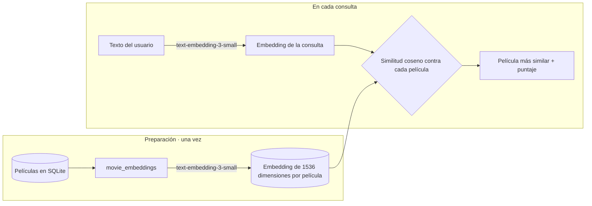

# Movie Reviews: recomendador de películas con embeddings

Aplicación web en **Django** para explorar un catálogo de películas y recibir **recomendaciones en lenguaje natural**. El usuario describe lo que quiere ver ("una película de aventuras con animales para ver en familia") y la app devuelve la película más parecida, comparando el **embedding** de la descripción con los embeddings de todo el catálogo mediante **similitud coseno**.

Taller individual, Universidad EAFIT (2025-2).

## Funcionalidades

- **Recomendación semántica** (`/recommendations/`): convierte el texto del usuario en un embedding con `text-embedding-3-small` de OpenAI y devuelve la película con mayor similitud coseno, junto con su puntaje.
- **Catálogo con búsqueda** (`/`): lista las películas con imagen y descripción, con búsqueda por título.
- **Estadísticas** (`/statistics/`): gráficas de películas por año y por género, generadas con matplotlib.
- **Noticias** (`/news/`): sección de noticias ordenadas por fecha, administrables desde el panel de Django.
- **Panel de administración** (`/admin/`) para gestionar películas y noticias.

## Cómo funciona la recomendación



1. El comando `movie_embeddings` genera un embedding por película a partir de su descripción y lo guarda como binario en el modelo `Movie` (campo `emb`).
2. Cuando el usuario envía su consulta, se genera su embedding con el mismo modelo.
3. Se calcula la similitud coseno contra cada película y se devuelve la de mayor puntaje.

La base de datos incluida (`db.sqlite3`) ya trae **96 películas con sus embeddings**, así que el catálogo funciona sin generarlos de nuevo. Para las recomendaciones sí se necesita una API key de OpenAI, porque cada consulta se convierte en embedding en el momento.

## Comandos de gestión

Están en `movie/management/commands/` y se ejecutan con `python manage.py <comando>`:

| Comando | Qué hace |
|---|---|
| `add_movies_db` | Carga las primeras 100 películas de `movies.json` (dataset de 46.014 películas) |
| `movie_embeddings` | Genera y guarda el embedding de cada película con OpenAI |
| `movie_similarities` | Compara dos películas, y opcionalmente un texto, por similitud coseno |
| `view_random_embedding` | Muestra el embedding de una película al azar |
| `update_descriptions` | Reescribe las descripciones con `gpt-3.5-turbo` |
| `update_movies_from_csv` | Carga descripciones actualizadas desde `updated_movie_descriptions.csv` |
| `update_images` | Genera la imagen de una película con OpenAI (demostración: solo la primera) |
| `update_images_from_folder` | Asigna imágenes a las películas desde `media/movie/images/` |

## Tecnologías

Python · Django 5 · SQLite · OpenAI API (embeddings, chat e imágenes) · NumPy · pandas · matplotlib · Pillow

## Cómo ejecutarlo

```bash
git clone https://github.com/sscalderod/Taller1-P1-20252.git
cd Taller1-P1-20252
python3 -m venv .venv
source .venv/bin/activate
pip install django pillow pandas matplotlib openai python-dotenv numpy requests
```

Crea un archivo `openAI.env` en la raíz con tu API key de OpenAI (está en `.gitignore`, así que no se sube):

```
openai_apikey=sk-...
```

Luego:

```bash
python manage.py migrate
python manage.py runserver
```

Abre http://127.0.0.1:8000/. Para regenerar los datos desde cero: `add_movies_db`, luego `update_movies_from_csv` y por último `movie_embeddings`.

## Estructura

```
moviereviews/       configuración del proyecto, URLs y plantilla base
movie/              modelo Movie, catálogo, estadísticas y comandos de gestión
recommendations/    vista de recomendación por embeddings
news/               modelo y vista de noticias
movies_initial.csv  dataset original de películas
cvs_to_json.py      conversión del CSV a JSON
```

## Autor

**Samuel Calderón Duque**: [GitHub](https://github.com/sscalderod) · [LinkedIn](https://www.linkedin.com/in/samuel-calderon-duque-b8772b37a/)
