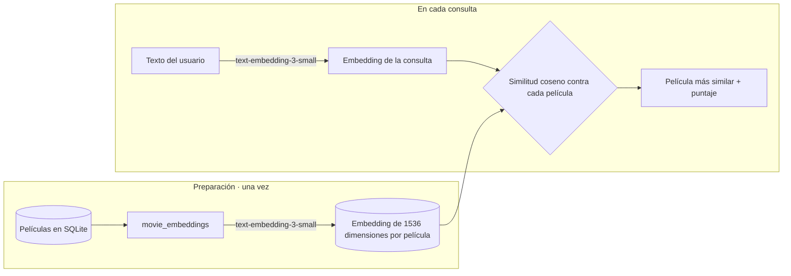

# Movie Reviews: recomendador de películas con embeddings

Aplicación web en **Django** para explorar un catálogo de películas y recibir **recomendaciones en lenguaje natural**. El usuario describe lo que quiere ver ("una película de aventuras con animales para ver en familia") y la app devuelve la película más parecida, comparando el **embedding** de la descripción con los embeddings de todo el catálogo mediante **similitud coseno**.

Taller individual, Universidad EAFIT (2025-2).

## Funcionalidades

- **Recomendación semántica** (`/recommendations/`): convierte el texto del usuario en un embedding con `text-embedding-3-small` de OpenAI y devuelve la película con mayor similitud coseno, junto con su puntaje.
- **Catálogo con búsqueda** (`/`): lista las películas con imagen y descripción, con búsqueda por título.
- **Estadísticas** (`/statistics/`): gráficas de películas por año y por género, generadas con matplotlib.
- **Noticias** (`/news/`): sección de noticias ordenadas por fecha, administrables desde el panel de Django.
- **Panel de administración** (`/admin/`) para gestionar películas y noticias.

## Cómo funciona la recomendación



1. El comando `movie_embeddings` genera un embedding por película a partir de su descripción y lo guarda como binario en el modelo `Movie` (campo `emb`).
2. Cuando el usuario envía su consulta, se genera su embedding con el mismo modelo.
3. Se calcula la similitud coseno contra cada película y se devuelve la de mayor puntaje.

El repositorio incluye los datos como fixtures (`movie/fixtures/movies.json` y `news/fixtures/news.json`): **96 películas con sus embeddings** y 3 noticias. Así el catálogo funciona sin volver a generarlos. Para las recomendaciones sí se necesita una API key de OpenAI, porque cada consulta se convierte en embedding en el momento.

## Comandos de gestión

Están en `movie/management/commands/` y se ejecutan con `python manage.py <comando>`:

| Comando | Qué hace |
|---|---|
| `add_movies_db` | Carga las primeras 100 películas de `movies.json` (dataset de 46.014 películas) |
| `movie_embeddings` | Genera y guarda el embedding de cada película con OpenAI |
| `movie_similarities` | Compara dos películas, y opcionalmente un texto, por similitud coseno |
| `view_random_embedding` | Muestra el embedding de una película al azar |
| `update_descriptions` | Reescribe las descripciones con `gpt-3.5-turbo` |
| `update_movies_from_csv` | Carga descripciones actualizadas desde `updated_movie_descriptions.csv` |
| `update_images` | Genera la imagen de una película con OpenAI (demostración: solo la primera) |
| `update_images_from_folder` | Asigna imágenes a las películas desde `media/movie/images/` |

## Tecnologías

Python · Django 5 · SQLite · OpenAI API (embeddings, chat e imágenes) · NumPy · pandas · matplotlib · Pillow

## Cómo ejecutarlo

```bash
git clone https://github.com/sscalderod/Taller1-P1-20252.git
cd Taller1-P1-20252
python3 -m venv .venv
source .venv/bin/activate
pip install -r requirements.txt
```

**Configuración.** Los secretos se leen de variables de entorno y nunca se escriben en el código. Ninguno de estos archivos se sube al repositorio:

```bash
cp .env.example .env              # DJANGO_SECRET_KEY, DJANGO_DEBUG, DJANGO_ALLOWED_HOSTS
echo "openai_apikey=sk-..." > openAI.env
```

Con `DJANGO_DEBUG=True` y sin `DJANGO_SECRET_KEY`, la app usa una clave temporal, lo cual solo sirve para desarrollo local. Con `DEBUG` apagado, `DJANGO_SECRET_KEY` es obligatoria y la app no arranca sin ella.

**Base de datos y datos de ejemplo.**

```bash
python manage.py migrate
python manage.py loaddata movies news      # 96 películas con embeddings y 3 noticias
python manage.py createsuperuser           # opcional, para entrar a /admin/
python manage.py runserver
```

Abre http://127.0.0.1:8000/. Para regenerar los datos desde cero, ejecuta `add_movies_db`, luego `update_movies_from_csv` y por último `movie_embeddings`.

**Para desplegar** en un servidor: `DJANGO_DEBUG=False`, una `DJANGO_SECRET_KEY` propia y la IP o el dominio del servidor en `DJANGO_ALLOWED_HOSTS`.

## Estructura

```
moviereviews/       configuración del proyecto, URLs y plantilla base
movie/              modelo Movie, catálogo, estadísticas, comandos de gestión y fixture de películas
recommendations/    vista de recomendación por embeddings
news/               modelo, vista y fixture de noticias
.env.example        plantilla de configuración
movies_initial.csv  dataset original de películas
cvs_to_json.py      conversión del CSV a JSON
```

## Autor

**Samuel Calderón Duque**: [GitHub](https://github.com/sscalderod) · [LinkedIn](https://www.linkedin.com/in/samuel-calderon-duque-b8772b37a/)
